# RTX 4090 Local vs Cloud Coding Benchmark

Sixteen local models on one RTX 4090 (24 GB) and six cloud settings, run through the same eight coding tasks,
three times each, and graded by programs instead of opinions. One local model was also tested on two inference
engines, and the best setups were tested at 256K context and with several users at once.

**Claude Opus 5.5 designed the benchmark**: every prompt, fixture repository, hidden test and grader. Opus itself
was not a contestant. This is the follow-up to
[rtx4090-local-llm-workflow-benchmark](https://github.com/Howard159357/rtx4090-local-llm-workflow-benchmark):
newer models, harder tasks, repeated runs, long-context stress, engine comparisons and a cloud baseline.

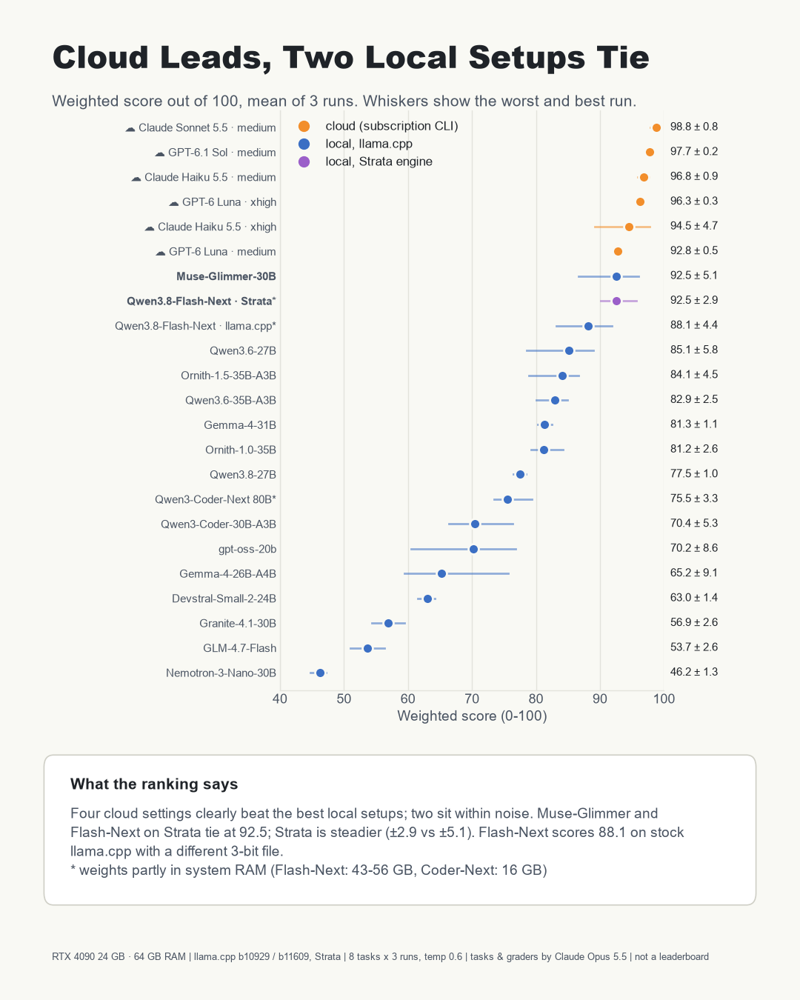

## Headline

- **Cloud still leads.** Claude Sonnet 5.5 scored 98.8. Every cloud setting scores at or above the best local
  setups; four are clearly ahead, while Haiku xhigh (94.5 ± 4.7) and GPT-6 Luna medium (92.8) sit within noise of it.
- **Two local setups tie at 92.5.** Muse-Glimmer-30B runs entirely on the GPU. Qwen3.8-Flash-Next runs on the
  Strata engine with 43-47 GB of its experts in system RAM, and is steadier (±2.9 vs ±5.1).
- **The gap left is reading a repository.** On six of eight tasks the best local score is within 3 points of
  Sonnet 5.5, and on the agent task Flash-Next on Strata scores higher. Task E is still 7 points behind.
- **The engine matters as much as the model.** On the identical 3-bit file, Flash-Next generates 33 tok/s on
  llama.cpp and 170 tok/s on Strata (5.2x).
- **One user and several users want different setups.** Strata is fastest for one person; Muse-Glimmer on
  llama.cpp serves four people at 237 tok/s combined.

## Why This Exists

The first benchmark told me how to route models on my workstation. It left questions open:

- Are the newest local models close to cloud models on real work?
- Is a single run trustworthy, or does the ranking move when you repeat it?
- When a model accepts 128K or 256K tokens, does it actually read them?
- Can a model that does not fit in 24 GB still be useful, and does the inference engine change the answer?

## What This Is Not

- Not a universal leaderboard. One GPU, one machine, eight tasks in one domain.
- Not an API price study. Cloud models ran through subscription CLIs (Claude Code, Codex), with no API fees.
- Not a judge-model evaluation. All scoring is programmatic: tests, executed queries, field checks, recall lists.

## Setup

| Item | Value |
|---|---|
| Machine | NVIDIA RTX 4090 24 GB, Ryzen 9 7950X3D, 64 GB RAM, Windows 11 |
| Local engines | llama.cpp `llama-server` b10929 (Sept 12) and b11609 (Oct 14); Strata v0.1.44.1 built from source |
| Local models | 16 models, GGUF 3-4 bit; plus MTP / DFlash speculative-decoding variants |
| Cloud settings | Claude Sonnet 5.5 medium, Claude Haiku 5.5 medium / xhigh, GPT-6.1 Sol medium, GPT-6 Luna medium / xhigh |
| Cloud harness | Claude Code CLI and Codex CLI, built-in shell / web / plugins disabled, empty working folder |
| Repeats | 3 runs per setup, temperature 0.6, seeds 11 / 22 / 33 (cloud: 3 runs, temperature not settable) |
| Reasoning | off for every local run (Strata: `reasoning_effort: none`); cloud at the stated effort level |
| Output cap | local 8,192 tokens including reasoning; cloud 32K with CLI continuation |
| Test designer | Claude Opus 5.5, in Claude Code |

## The Tasks

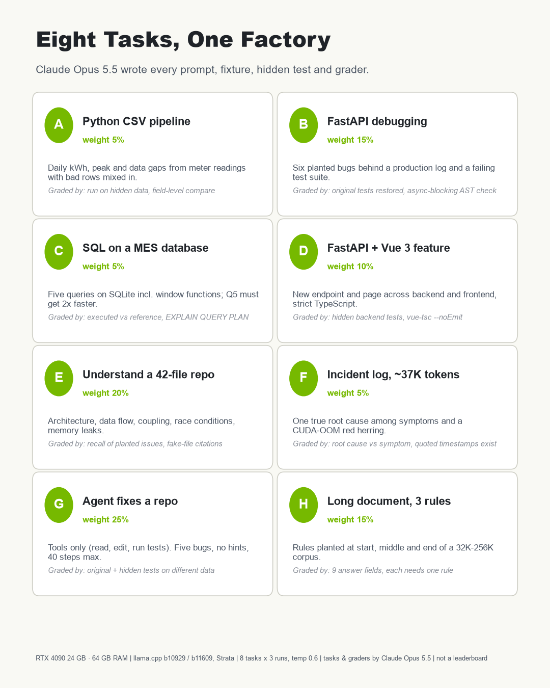

All eight tasks live in one manufacturing domain (a factory energy / MES system), so models cannot lean on
memorised public benchmarks.

| | Task | What the model gets | How it is graded |
|---|---|---|---|
| A | Python CSV pipeline | spec for daily kWh, peak and gap detection; input has malformed rows | program run on hidden data, field-level compare; its own pytest run |
| B | FastAPI debugging | service with 6 planted bugs, production log, failing tests | original tests restored and run (up to 3 iterations), AST check for blocking DB calls in async handlers, root-cause recall |
| C | SQL on SQLite MES DB | schema and 5 query specs; Q5 must also be made 2x faster | each query executed against a reference; EXPLAIN QUERY PLAN index use |
| D | FastAPI + Vue 3 feature | 2-tier repo; add an endpoint and a page with an SVG chart | hidden backend tests, `vue-tsc --noEmit`, API contract checks |
| E | Understand a 42-file repo | full source; 6 questions on architecture, data flow, coupling, races, leaks | recall of planted issues; citing a file that does not exist costs points |
| F | Incident log, ~37K tokens | noisy multi-service log | one planted root cause vs symptoms and a CUDA-OOM red herring; quoted timestamps must exist |
| G | Agent fixes a repo | tools only: list, read, edit, run tests; 5 bugs, no hints, 40 steps | independent run of original + hidden tests on different data |
| H | Long document | 3 binding rules hidden at start, middle and end of a 32K-256K corpus | 9 answer fields, each depends on exactly one rule |

## Scoring

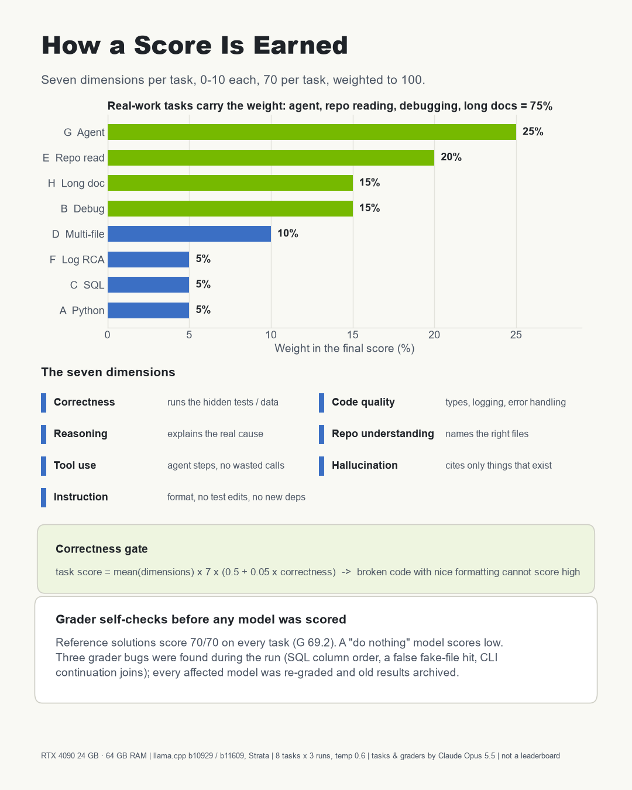

- Seven dimensions, 0-10 each: correctness, code quality, reasoning, repo understanding, tool use,
  hallucination, instruction following. Dimensions that do not apply to a task are dropped and the rest rescaled.
- **Correctness gate:** `task = mean(dimensions) x 7 x (0.5 + 0.05 x correctness)`. Clean formatting cannot rescue
  broken code.
- **Weights:** G 25%, E 20%, B 15%, H 15%, D 10%, A / C / F 5% each. The real-work tasks carry 75%.
- **Grader validation:** reference solutions score 70/70 (G 69.2); a do-nothing model scores low. Three grader bugs
  surfaced during the runs; each fix was followed by re-grading every affected model, and old results were archived.

## Results

### Overall

| # | Setup | Score (3 runs) | Gen tok/s @32K | Max ctx in 24 GB |
|---|---|---|---|---|
| ☁ | Claude Sonnet 5.5 · medium | **98.8 ± 0.8** | – | – |
| ☁ | GPT-6.1 Sol · medium | 97.7 ± 0.2 | – | – |
| ☁ | Claude Haiku 5.5 · medium | 96.8 ± 0.9 | – | – |
| ☁ | GPT-6 Luna · xhigh | 96.3 ± 0.3 | – | – |
| ☁ | Claude Haiku 5.5 · xhigh | 94.5 ± 4.7 | – | – |
| ☁ | GPT-6 Luna · medium | 92.8 ± 0.5 | – | – |
| 1 | **Qwen3.8-Flash-Next · Strata** (43-47 GB in RAM) | **92.5 ± 2.9** | 170 | 128K default, 256K tested |
| 1 | **Muse-Glimmer-30B** (+ DFlash) | **92.5 ± 5.1** | 46 (127) | 128K |
| 3 | Qwen3.8-Flash-Next · llama.cpp (56 GB in RAM) | 88.1 ± 4.4 | 27 (41 with MTP, b11609) | 64K tested |
| 4 | Qwen3.6-27B (+ MTP) | 85.1 ± 5.8 | 43 (119) | 188K (132K) |
| 5 | Ornith-1.5-35B-A3B | 84.1 ± 4.5 | 161 | 212K |
| 6 | Qwen3.6-35B-A3B | 82.9 ± 2.5 | 162 | 256K |
| 7 | Gemma-4-31B QAT | 81.3 ± 1.1 | 34 | 112K |
| 8 | Ornith-1.0-35B | 81.2 ± 2.6 | 161 | 212K |
| 9 | Qwen3.8-27B (+ MTP) | 77.5 ± 1.0 | 49 (153) | 256K (168K) |
| 10 | Qwen3-Coder-Next 80B (partial CPU) | 75.5 ± 3.3 | 49 | 64K tested |
| 11 | Qwen3-Coder-30B-A3B | 70.4 ± 5.3 | 115 | 136K |
| 12 | gpt-oss-20b | 70.2 ± 8.6 | 171 | 128K |
| 13 | Gemma-4-26B-A4B QAT | 65.2 ± 9.1 | 134 | 256K |
| 14 | Devstral-Small-2-24B | 63.0 ± 1.4 | 47 | 104K |
| 15 | Granite-4.1-30B (KV q4_0) | 56.9 ± 2.6 | 36 | 80K |
| 16 | GLM-4.7-Flash | 53.7 ± 2.6 | 103 | 198K |
| 17 | Nemotron-3-Nano-30B | 46.2 ± 1.3 | 202 | 1024K |

The two Flash-Next rows use different 3-bit files (ISTA-DASLab GSQ-RCO on Strata, unsloth UD-IQ3_XXS on
llama.cpp). A follow-up run of the GSQ-RCO file on llama.cpp scored 89.0, so most of the 4.4-point gap leans
towards the engine, though not conclusively (see [Same file, two engines: quality](#same-file-two-engines-quality)).

### Per task

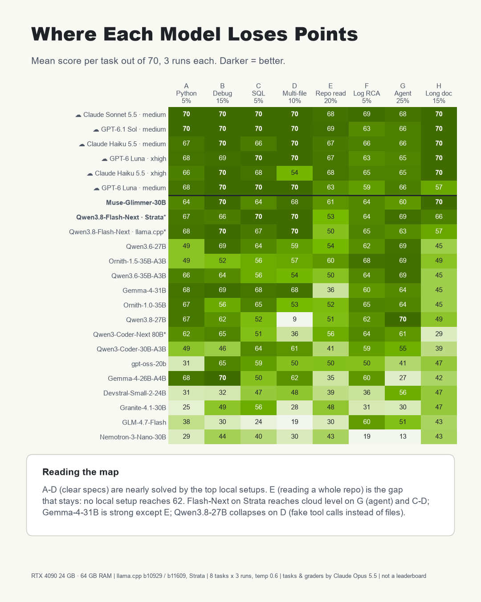

### Cloud vs local

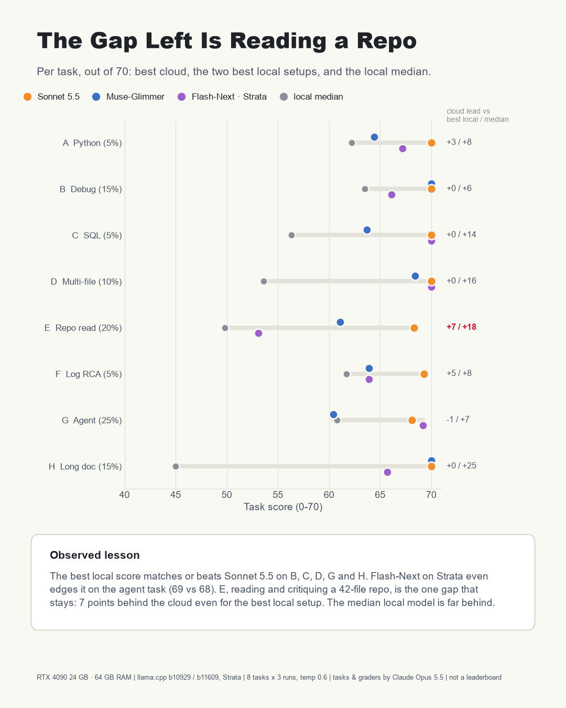

| Task | Sonnet 5.5 | Muse-Glimmer | Flash-Next · Strata | Best local vs cloud |
|---|---:|---:|---:|---:|
| A Python | 70.0 | 64.4 | 67.2 | -2.8 |
| B Debug | 70.0 | 70.0 | 66.1 | 0 |
| C SQL | 70.0 | 63.7 | 70.0 | 0 |
| D Multi-file | 70.0 | 68.4 | 70.0 | 0 |
| **E Repo read** | **68.3** | 61.1 | 53.1 | **-7.2** |
| F Log RCA | 69.3 | 63.9 | 63.9 | -5.4 |
| G Agent | 68.1 | 60.4 | **69.2** | **+1.1** |
| H Long doc | 70.0 | 70.0 | 65.7 | 0 |

- Cloud runs at medium effort are steadier (±0.2-0.9 versus ±1-9 locally; Haiku at xhigh is the exception at ±4.7)
  and almost never fail a task outright.
- The weakest spot for both top local setups is E: naming tightly coupled modules and proposing a multi-user design.

## Error Analysis

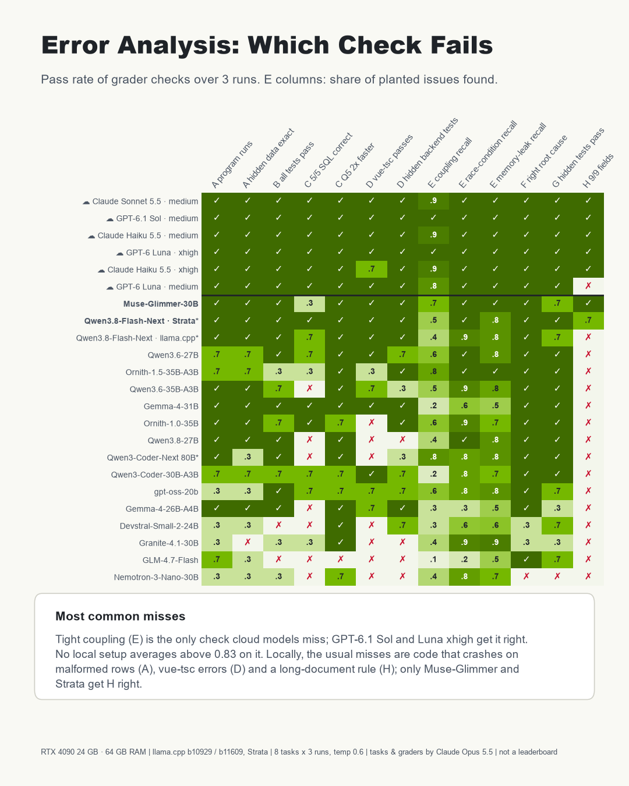

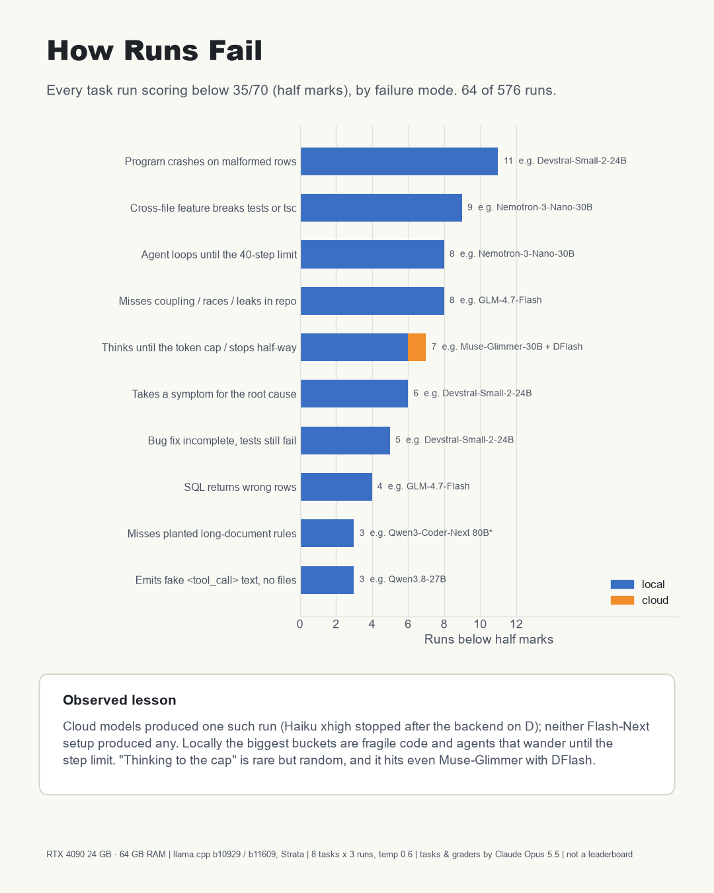

64 of 576 task runs scored below half marks. One was a cloud run; none came from either Flash-Next setup.

| Failure mode | Runs | Typical models | What happened |
|---|---:|---|---|
| Program crashes on malformed rows (A) | 11 | Granite, Devstral, gpt-oss, Nemotron | requirement 7 ("skip bad rows, do not crash") ignored |
| Cross-file feature breaks tests or tsc (D) | 9 | Nemotron, Coder-Next, Granite | backend contract wrong or `vue-tsc` errors |
| Agent loops until the step limit (G) | 8 | Nemotron, Gemma-4-26B, Granite | re-reads the same file or `git log` 40 times; Granite also edited tests |
| Misses coupling / races / leaks (E) | 8 | GLM, Gemma-4-26B, Devstral | tight coupling is the only check the cloud models miss; no local setup averages above 0.83 |
| Thinks to the token cap / stops half-way | 7 | Muse-Glimmer + DFlash, GLM, Nemotron, Haiku xhigh | reasoning eats the output budget and no code is delivered |
| Symptom taken as root cause (F) | 6 | Devstral, Granite, Nemotron | DB timeouts or the CUDA-OOM red herring reported as the cause |
| Bug fix incomplete (B) | 5 | Devstral, GLM, Qwen3-Coder-30B | tests still fail after 3 iterations |
| SQL returns wrong rows (C) | 4 | GLM, Nemotron | 2-4 of 5 queries differ from the reference result |
| Misses long-document rules (H) | 3 | Qwen3-Coder-Next | 5/9 fields in all three runs |
| Fake `<tool_call>` text instead of files (D) | 3 | Qwen3.8-27B | writes tool-call markup in a text-only task, all three runs |

A softer failure does not show up in that table: Flash-Next on llama.cpp scored 48.2 on the agent task in two of
four runs, fixing one bug only well enough to pass the visible tests before declaring itself done.

## Efficiency

### Generation ("output speed")

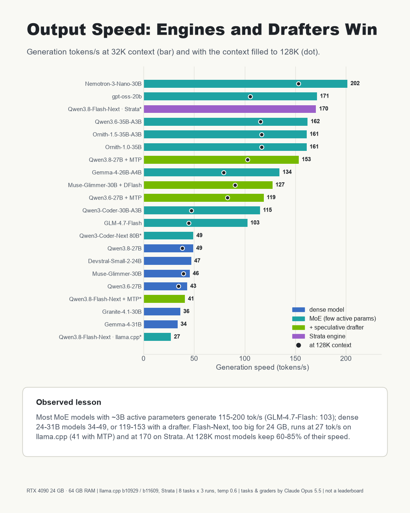

### Reading ("prompt processing" and time to first token)

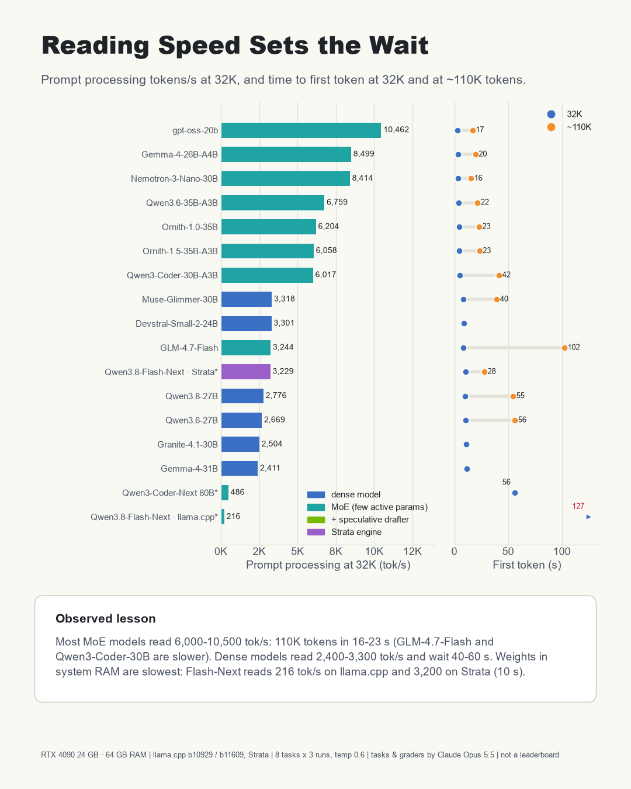

### Quality against speed

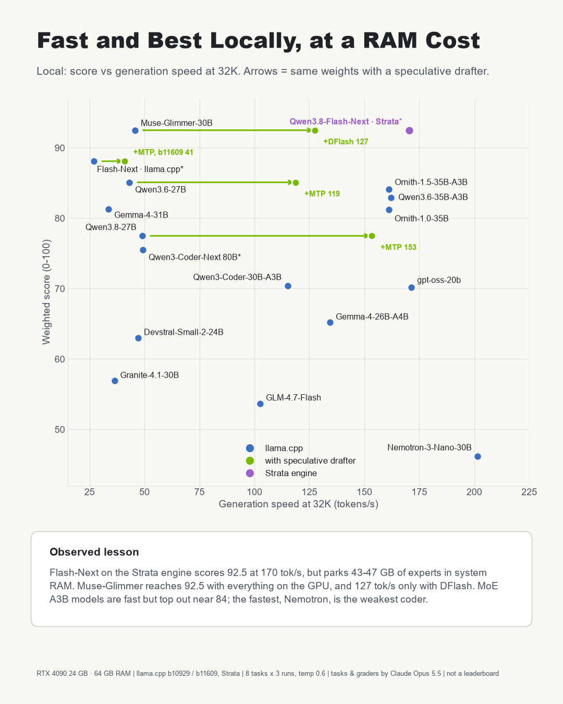

- Most MoE models with about 3B active parameters generate 115-200 tok/s and read 6,000-10,500 tok/s; GLM-4.7-Flash
  is the exception (103 tok/s, reads 3,244).
- Dense 24-31B models generate 34-49 tok/s. A speculative drafter lifts them to 119-153 tok/s at +1.4 to +2.4 GB VRAM;
  the cost is a shorter usable context (Qwen3.6-27B: 188K to 132K). Only DFlash was re-scored over three runs: 86.2
  against 92.5 without it, about 1.9 standard errors, so not conclusive; the MTP variants were measured for speed only.
- Flash-Next on Strata is the only top-scoring local setup that is fast out of the box (Strata's MTP drafter is
  built in). Its cost is system RAM, not VRAM.

### Time and tokens per round

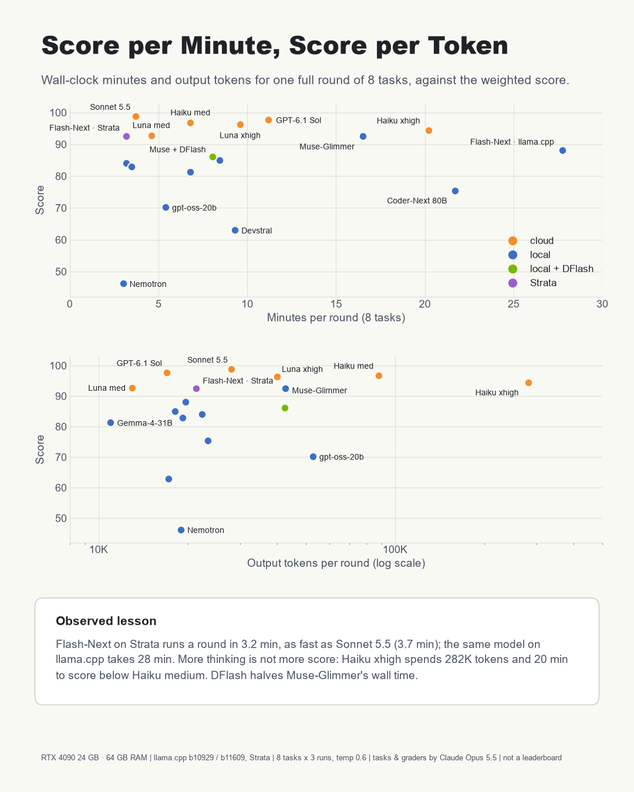

Flash-Next on Strata runs all eight tasks in 3.2 minutes, as fast as Sonnet 5.5 (3.7). The same model on llama.cpp
takes 28 minutes. Claude Haiku 5.5 at xhigh spends 282K tokens and 20 minutes to score lower than at medium.

## Engines and Builds

### Same model, different engine

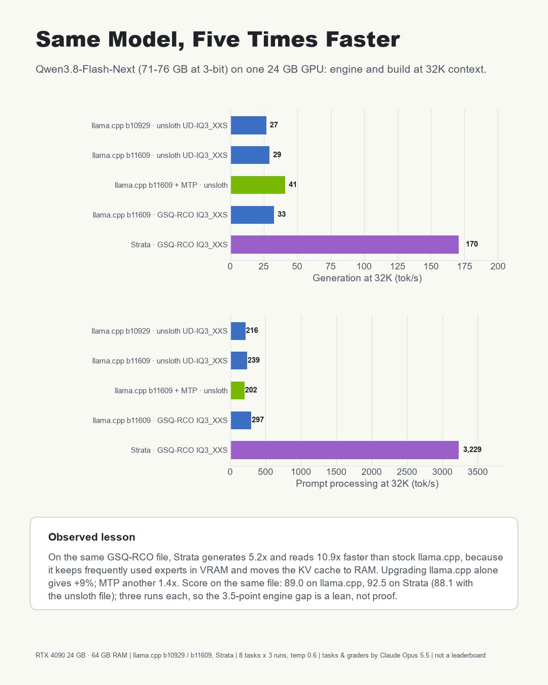

Qwen3.8-Flash-Next (about 125B parameters plus a 51B n-gram table, 71-76 GB at 3-bit depending on the file) cannot fit in 24 GB.

| Setup at 32K | Generate tok/s | Read tok/s | First token |
|---|---:|---:|---:|
| llama.cpp b10929, unsloth file | 27.0 | 216 | 127 s |
| llama.cpp b11609, unsloth file | 29.4 | 239 | 115 s |
| llama.cpp b11609 + MTP (n-max 3) | 40.9 | 202 | 136 s |
| llama.cpp b11609, GSQ-RCO file | 32.8 | 297 | 92 s |
| **Strata, GSQ-RCO file** | **170.5** | **3,229** | **10 s** |

- On the same file, Strata generates 5.2x and reads 10.9x faster. It batches expert loads during reading, keeps the
  most-used experts in VRAM, moves the KV cache to RAM and uses its own MTP drafter (70-90% acceptance).
- Strata was compiled from source after a code review; its prebuilt binaries have no public CI. It needs VS 2022
  Build Tools and CUDA 12.9, and it is not managed by my llama.cpp desktop tool.

### Same file, two engines: quality

A follow-up run (October 21, same settings, 3 seeds) scored the GSQ-RCO file on llama.cpp b11609, so file and engine
can be separated:

| File | Engine | Score (3 runs) | Range |
|---|---|---|---|
| unsloth UD-IQ3_XXS | llama.cpp b10929 | 88.1 ± 4.4 | 83.3-91.8 |
| GSQ-RCO IQ3_XXS | llama.cpp b11609 | 89.0 ± 1.3 | 87.5-90.2 |
| GSQ-RCO IQ3_XXS | Strata | 92.5 ± 2.9 | 90.1-95.7 |

- **The file moves where points come from, not the total.** With the GSQ-RCO file on llama.cpp the agent task (G)
  scored 70 in all three runs and the mid-document rule (H, 32K) was found every time; the unsloth file missed it
  every time. Python (A) and SQL (C) dropped, so the total moved only +0.9.
- **The engine gap on the same file is 3.5 points**, about 1.9 standard errors over three runs each: a lean towards
  Strata, not proof. It comes from A (one run whose program failed on the hidden data, 13.3/70), C (two runs with two
  wrong queries) and E. An engine should not change what the model knows; numerical and sampling differences make
  the same seed produce different answers.
- The run is kept out of the main ranking and run counts above; per-seed scores are in `data/source/engine-file-test.csv`.

### llama.cpp b10929 vs b11609

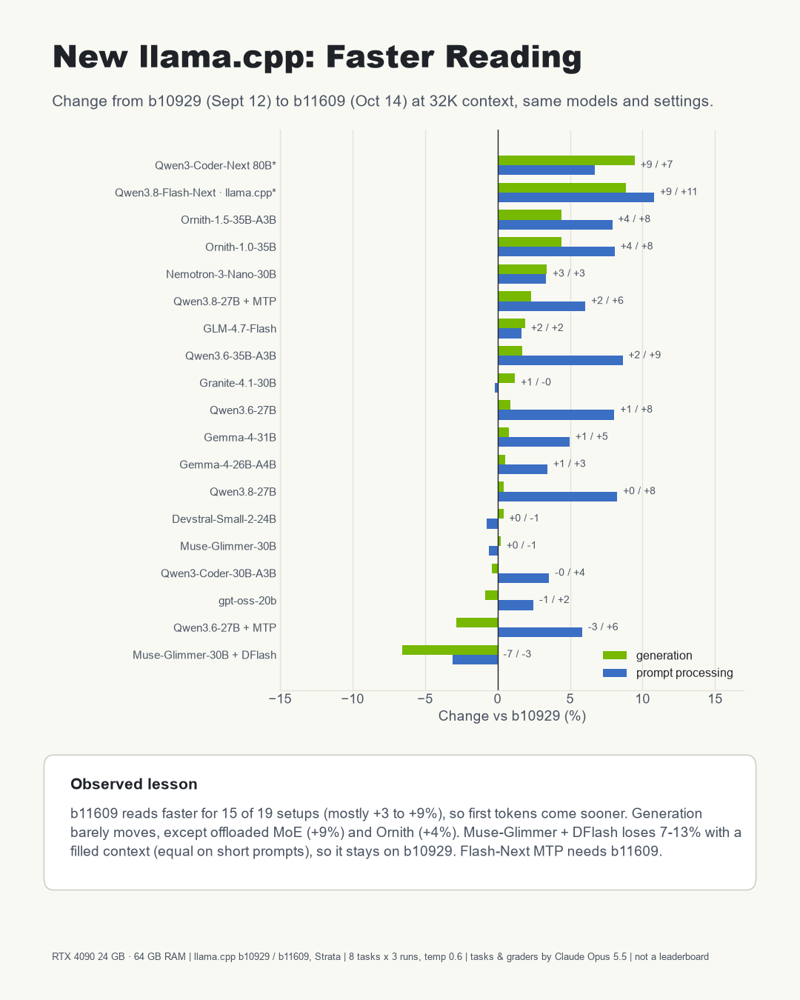

- Reading got faster for 15 of 19 setups, mostly by 3-9%. Generation barely moved, except offloaded MoE models (+9%)
  and Ornith (+4%).
- Muse-Glimmer + DFlash lost 7-13% with a filled context (equal on short prompts), so it stays on b10929.
- Flash-Next's MTP head only loads on b11609 (llama.cpp PR #29761).

## Several Users at Once

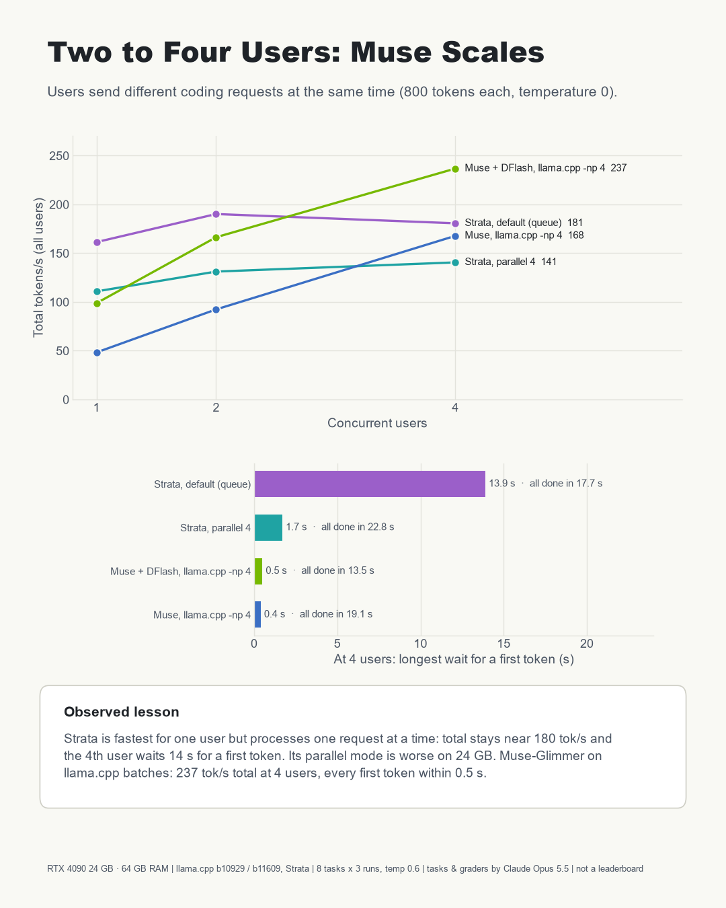

One, two and four users sent different coding requests at the same time (800 tokens each).

| Setup | Total tok/s, 1 / 2 / 4 users | 4 users: longest first-token wait | 4 users: all done |
|---|---|---:|---:|
| Strata, default (one request at a time) | 161 / 190 / 181 | 13.9 s | 17.7 s |
| Strata, parallel 4 | 111 / 131 / 141 | 1.7 s | 22.8 s |
| **Muse-Glimmer + DFlash, llama.cpp -np 4** | 99 / 166 / **237** | **0.5 s** | **13.5 s** |
| Muse-Glimmer, llama.cpp -np 4 | 48 / 92 / 168 | 0.4 s | 19.1 s |

- Strata's total throughput does not grow with users; with long agent tasks the queue becomes minutes.
- Strata's parallel mode is slower than queueing on 24 GB: parallel slots take VRAM away from cached experts.
- Muse-Glimmer on llama.cpp batches well: 2.4x total throughput at four users, first tokens within half a second.

## Long Context

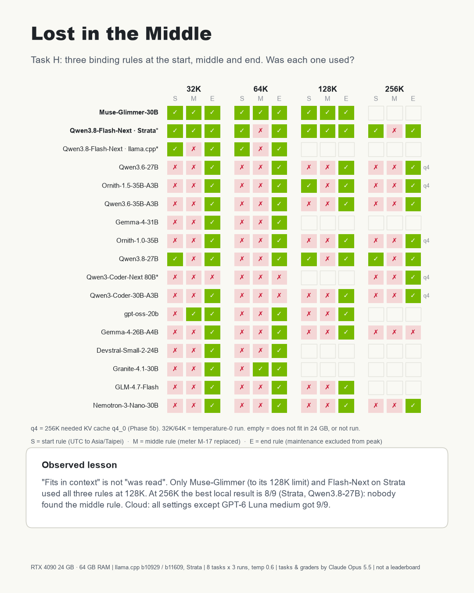

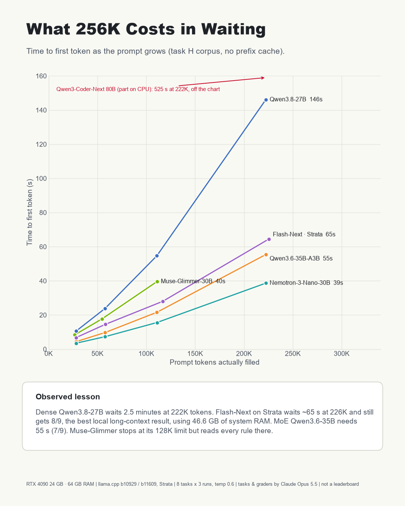

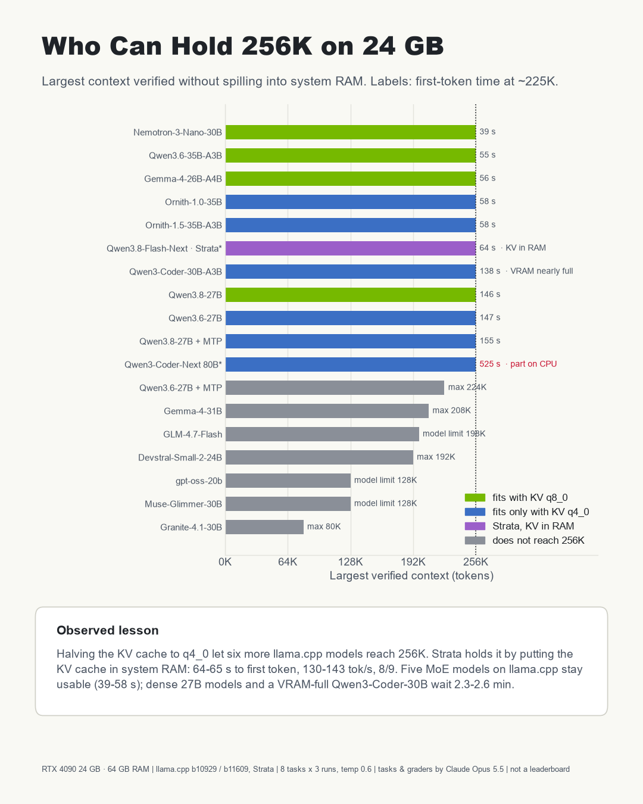

Phase 5 filled each local model to about 85% of 128K and 256K (when it fits in 24 GB), measured speed and VRAM,
and re-ran task H on 117K- and 234K-token documents at temperature 0.

- **Fits is not read.** At 128K only Muse-Glimmer and Flash-Next on Strata used all three rules. At 256K the best
  local result is 8/9 (Flash-Next on Strata, Qwen3.8-27B), and no local setup found the mid-document rule.
- Most models already used only the last rule at 32K, so longer context did not make them worse. Gemma-4-26B fell
  to 6/9 at 256K and GLM-4.7-Flash to 6/9 at 128K.
- **Phase 5b:** halving the KV cache to q4_0 let six more llama.cpp models hold 256K, ten in total. On task H only
  Ornith-1.5 changed (8/9 at 128K, 7/9 at 256K; this test cannot tell q4_0 from length). Qwen3.6-27B + MTP, Gemma-4-31B and Devstral still top out at 224K, 208K and 192K.
- **Strata at 256K:** about 65 s to first token, 130-143 tok/s, 8/9, using 46.6 GB of system RAM and 22.6 GB VRAM.
- At 256K, five MoE models on llama.cpp stay usable (Nemotron, Qwen3.6-35B, Gemma-4-26B, Ornith-1.0 / 1.5): 39-58 s
  to first token and 52-114 tok/s. The dense 27B models and Qwen3-Coder-30B, whose VRAM is nearly full, wait
  2.3-2.6 minutes. Qwen3-Coder-Next with CPU offload waits 525 s.
- No llama.cpp run spilled into system RAM through WDDM; the closest was Qwen3-Coder-30B at 256K with 23.5 GB.
- Cloud: every setting except GPT-6 Luna medium scored 9/9 on H, but cloud runs used only the 32K and 64K
  documents; they were not tested at 128K or 256K.

## Reasoning Level and Repeatability

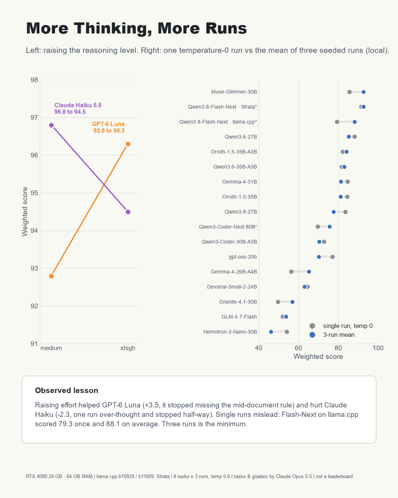

- Raising reasoning effort helped GPT-6 Luna (+3.5: it stopped missing the mid-document rule) and hurt Claude Haiku
  (-2.3: one run thought for 45K tokens on D and stopped after the backend).
- Single runs mislead. Flash-Next on llama.cpp scored 79.3 in its temperature-0 run and 88.1 on average; gpt-oss-20b
  dropped 6.8 points and Gemma-4-26B rose 8.9 once three seeds were averaged.

## Videos

Five short, silent clips (1080x1350, 10-21 s) replayed from the measured timings in this repo, in `docs/assets/videos/`:

| File | What it shows |
|---|---|
| [`05_round_clock.mp4`](docs/assets/videos/05_round_clock.mp4) | One round of all 8 tasks for 8 setups, cloud and local, 120x time compression |
| [`04_typing_speed.mp4`](docs/assets/videos/04_typing_speed.mp4) | Before and after, the same function typed at measured speeds: Flash-Next on llama.cpp vs Strata with the same file (33 → 170 tok/s), Muse-Glimmer without and with DFlash (46 → 127 tok/s), real time |
| [`03_agent_replay.mp4`](docs/assets/videos/03_agent_replay.mp4) | Two real task-G transcripts side by side: 21 tool calls and finish, versus 40 shell commands and no edit |
| [`01_first_token_race.mp4`](docs/assets/videos/01_first_token_race.mp4) | Time to first token after a ~225K-token document, 10 setups, 10x time compression |
| [`02_four_users.mp4`](docs/assets/videos/02_four_users.mp4) | Four users at once: Strata queueing versus Muse-Glimmer on llama.cpp with 4 slots, real time |

They are generated by `scripts/make_videos.py`; code shown in the typing and multi-user clips is illustrative, every timing is measured.

## Routing

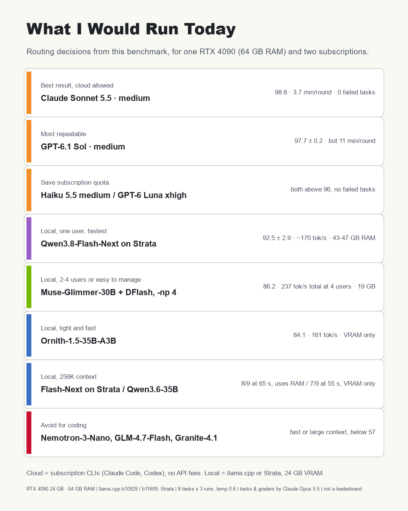

## Limitations

- **Designer bias.** Claude Opus 5.5 wrote the tasks and graders, and two contestants (Sonnet, Haiku) are Claude
  models. Programmatic grading limits this, but task style may still favour one model family.
- **Different budgets.** Local models had an 8,192-token output cap including reasoning; cloud CLIs had 32K with
  continuation. This favours long-thinking cloud settings.
- **Engine vs file.** On the same file, Strata leads llama.cpp by 3.5 points, which three runs per setup cannot
  confirm; the main Flash-Next rows still use two different files. Strata's speed run could not force a fixed output length, so a separate 1,500-token run checked it.
- **RAM matters.** Strata and the offloaded models depend on 64 GB of system RAM; on a 32 GB machine they will not run.
- **Agent step counts differ.** Claude reports model turns; for Codex, steps were estimated as tool calls + 1.
- **Context limits** were measured without a vision projector at ubatch 512. Adding vision shortens them.
- **KV q4_0 at 256K** (Phase 5b) differs from the q8_0 used everywhere else; those cells are marked `q4`.
- **Coverage.** Python, SQL, TypeScript/Vue only. No Rust, Go, or large refactors.

## Reproducibility

- `data/source/` holds the benchmark output tables (`repeat-runs`, `master-table`, `long-context`, `phase5-longctx`,
  `performance`, `agent-results`, `models`, `coding-quality`), `multiuser.json`, `strata-perf.json`,
  `phase5b-256k.csv`, transcribed from the Phase 5b and Strata 256K run logs, and `engine-file-test.csv` (the
  same-file quality run).
- `scripts/aggregate.py` and `scripts/checks.py` flatten the raw per-run JSON into `data/repeat-flat.csv` and
  `data/checks.csv`.
- Those two scripts and `scripts/make_videos.py` (video 03) read the raw run files from the folder in the `BENCH_RAW`
  environment variable; set it to the benchmark's `results/raw` folder first. The raw files are not part of this repo.
- `scripts/build_charts.py` renders every chart in `docs/assets/charts/` (one process per chart).
- The benchmark runner, tasks and graders live in a separate project; model weights are not included.

## License

Code: MIT. Documentation, charts and data: CC BY 4.0. Model weights are excluded and keep their own licenses.
